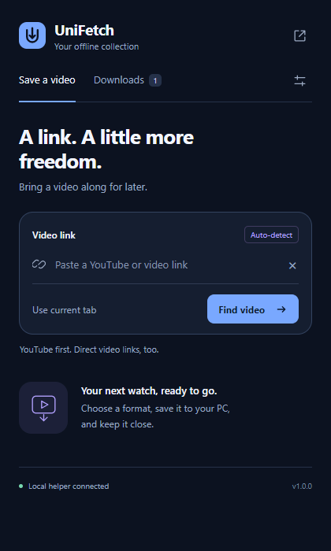

# UniFetch

**Version 1.0.0** — a personal video downloader for Chrome on Windows.

Paste a YouTube or direct video link, inspect the available formats, and save a local copy. A small native helper runs yt-dlp and FFmpeg on your PC. No cloud downloader or local web server is required.



## Install

Requirements: Windows x64, Chrome 120 or newer, Python 3.11 or newer available on PATH, and internet access for setup and downloads.

1. Download and extract the [v1.0.0 release](https://github.com/maripilikhith/UnitFetch/releases/tag/v1.0.0), or clone this repository.
2. Run **Setup UniFetch.cmd**. It installs dependencies inside the project and registers the helper for your Windows user.
3. Open `chrome://extensions`, enable **Developer mode**, choose **Load unpacked**, and select the **UniFetch** subfolder containing `manifest.json`.
4. Pin UniFetch, open it, and check for **Local helper connected** in the footer.

Keep the project folder in place after setup. If you move it, run setup again. Administrator privileges are not required. Use **Uninstall helper.cmd** to unregister the helper and remove the extension separately in Chrome.

## Features

- Automatic YouTube link recognition, including watch, short, Shorts, and embed URLs.
- Available quality and format selection with video-and-audio pairing.
- Local downloading, FFmpeg merging, and output verification.
- Direct MP4, WebM, M4V, and MOV downloads using Chrome's download manager.
- Progress, cancellation, duplicate prevention, recent history, and file-location shortcuts.
- Dark popup, expanded-tab view, preferred-quality settings, and readable errors.

YouTube files save to **Downloads / UniFetch**. One YouTube download runs at a time. Closing the popup leaves it running; closing Chrome interrupts it.

## Current limits

This is an experimental personal-use release. YouTube can require a sign-in or bot check, and some requests will fail. The helper completed a real sample download during testing; a later full-UI attempt encountered YouTube's bot check. [Verification details](TEST-RESULTS.md) distinguish these results.

Playlists, ongoing live streams, private/paid/DRM videos, arbitrary website extraction, and standalone HLS/DASH downloads are not supported. UniFetch does not import browser cookies, bypass authentication, or circumvent DRM. Use it only for media you are authorized to save.

## Source layout

| Path | Purpose |
| --- | --- |
| `UniFetch/` | Manifest V3 extension, popup, download handling, and storage. |
| `helper/` | Python native host, validation, extraction, process control, and setup. |
| `scripts/` | Validation, asset generation, and integration checks. |
| `UniFetch/tests/`, `helper/tests/` | JavaScript and Python tests. |
| `.github/workflows/validate.yml` | Windows source and helper CI. |

Downloaded dependencies, browser profiles, machine-specific registration files, and personal history are excluded from Git and the release ZIP. Setup downloads the official tools on the target PC. Dependency licensing and provenance are described in the [full guide](UniFetch/README.md#dependencies).

## Development

Node.js 22 or newer is needed for development checks, not for running the extension.

```powershell
npm run check
npm test
npm run test:helper
```

For optional browser integration checks, install the helper first, then:

```powershell
npm ci
npx playwright install chromium --no-shell
npm run fixture
npm run test:browser
```

The browser suite uses a separate test profile and an original generated media fixture. Live YouTube checks are opt-in and depend on the service's response. See [testing instructions](UniFetch/tests/README.md).

[Full installation and usage guide](UniFetch/README.md) · [Changelog](CHANGELOG.md) · [UI design notes](DESIGN.md)
